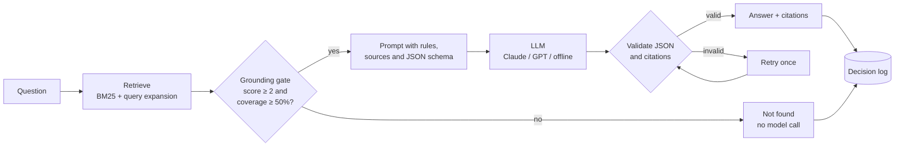

# Benefits Assistant: retrieval-augmented generation (RAG) with evaluation

[](https://github.com/adham-abdalla/benefits-assistant-rag/actions/workflows/ci.yml)


**▶ Live demo: [adham-abdalla.github.io/benefits-assistant-rag](https://adham-abdalla.github.io/benefits-assistant-rag/)** (runs in your browser; no key needed)

An assistant that answers employee questions about a group benefits booklet. It **only answers from the booklet**, **cites the sections it used**, **says "not found" instead of guessing**, and **logs every decision** so automated answers can be reviewed. A built-in evaluation suite measures quality on every change.

> *"How much do I get for new glasses?"* → "Eyeglasses or contact lenses are covered up to $250 every 24 months per person…" **[vision-care]**
> *"Does the plan cover my dog?"* → "I couldn't find this in the benefits booklet…" (the model is never called)

## How it works



| Feature | Details |
|---|---|
| **Retrieval** | Booklet split into sections; BM25 ranking (implemented from scratch); query expansion maps everyday words to booklet wording ("glasses" → eyeglasses, vision) |
| **Grounding gate** | Weak or off-topic matches are answered "not found" *before* calling a model: safer and cheaper |
| **Structured output** | The model must return JSON: `answer`, `citations`, `confidence`, `answerable` |
| **Validation** | Rejects malformed output and **invented citations** (a cited section must be one that was retrieved); retries once, then falls back safely |
| **Providers** | Anthropic and OpenAI adapters (temperature 0), plus a free deterministic offline answerer for demos and tests |
| **Decision log** | Question, retrieved sections with scores, provider, model, attempts, validation notes, token and cost estimate, latency |
| **REST API** | Express: `POST /api/ask`, `GET /api/log`, `GET /api/health`; keys stay on the server |
| **Evaluation** | 21-question development set with quality gates in CI, plus a 9-question **held-out set** reported honestly |

## Evaluation results (offline answerer)

| Metric | Development set (21) | Held-out set (9) |
|---|---|---|
| Retrieval hit@3 | 100% | 85.7% |
| Citation accuracy | 100% | 85.7% |
| Fact coverage | 100% | 71.4% |
| Correct refusals | 100% | 100% |
| **Pass rate** | **100%** | **77.8%** |

**What the numbers mean:** the first run on the development set scored only 61.9%. The failures showed three real problems: vocabulary mismatch, over-confident answers to off-topic questions, and a weak stemmer. I fixed these with query expansion, a coverage-based grounding gate and a better stemmer, which brought it to 100%. Because the fixes were tuned on that set, I then wrote a **held-out set** I never tuned for. It scores 77.8%. Both misses come from wording the keyword retriever can't connect ("psychologist" vs "psychology"), which is where embeddings or a real LLM help. Every off-topic question was correctly declined in both sets. Details are in [docs/DESIGN.md](docs/DESIGN.md).

## Run it

```bash
npm install
npm test                      # 13 unit tests + 4 API tests
npm run eval                  # quality report (exits 1 if below thresholds)
npm start                     # API on http://localhost:3001 (offline mode)
ANTHROPIC_API_KEY=... npm start   # or OPENAI_API_KEY=...

curl -X POST localhost:3001/api/ask -H 'content-type: application/json' \
     -d '{"question":"Is orthodontics covered?"}'
```

## Structure

```
src/core/
├── retrieval.js     Chunking, stemmer, query expansion, BM25 with coverage
├── answer.js        Prompt, JSON schema, validation, grounding gate, offline answerer
└── assistant.js     Pipeline, retries, provider adapters, decision log, cost estimate
server/              Express REST API (app.js, index.js)
eval/                questions.json, heldout.json, evaluate.js, run.js, results.json
web/ + index.html    Browser demo (same core code, runs client-side)
data/                Fictional benefits booklet
tests/               Unit tests (node:test) and API tests
docs/DESIGN.md       Architecture, responsible-AI decisions, evaluation method
```

## Next steps
- [ ] Embedding-based retrieval (hybrid with BM25) to close the held-out wording gap
- [ ] Run the evaluation against Claude and GPT and compare quality vs cost
- [ ] French booklet and bilingual answers

---
Built by **Adham Abdalla** · [GitHub](https://github.com/adham-abdalla) · MIT License · The booklet is fictional
